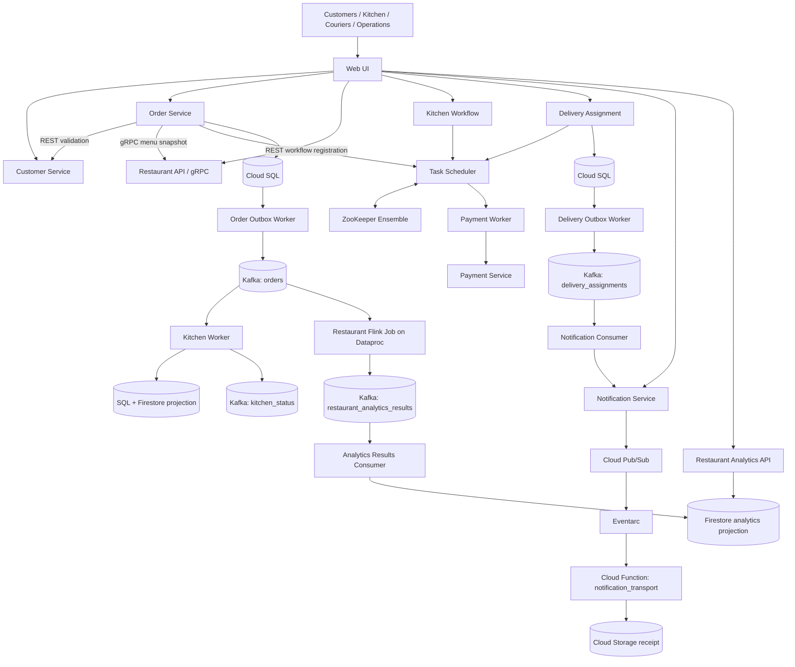
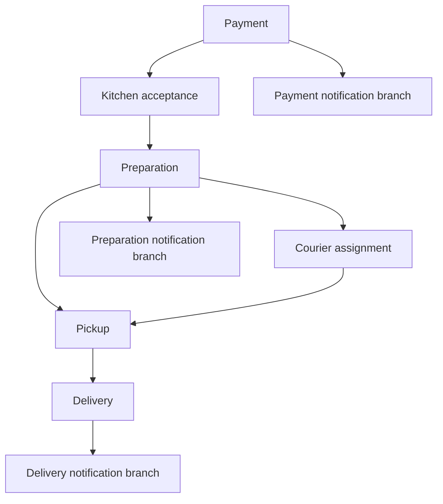

# CloudProject1 — System Design Document

**BITS Pilani · CS/SS G527 Cloud Computing**  
**Repository:** [utkarsharora100/CloudProject1](https://github.com/utkarsharora100/CloudProject1)  
**Design baseline:** `main` at `7fc954ebc22d01fe8ac9c1111103b521ecfb1e66`  
**Document status:** Repository-based design; managed-cloud acceptance is pending.

---

## Document control

| Item | Value |
|---|---|
| System | CloudProject1 food delivery orchestration platform |
| Primary cloud | Google Cloud Platform |
| Main runtime | Google Kubernetes Engine |
| Main implementation language | Python 3.12 |
| Infrastructure definition | Terraform, across five roots |
| Release management | Helm and Argo CD |
| External event platform | Confluent Cloud Kafka |
| Design basis | Repository source, deployment configuration and `CLOUD_DEPLOYMENT_HANDOFF.md` |

### How to read this document

This document describes the design encoded in the repository. It distinguishes source and configuration evidence from execution against managed cloud resources. Local test results are not treated as proof that GCP services, public HTTPS, managed Flink or cloud autoscaling have passed acceptance.

## Contents

1. [Purpose and scope](#1-purpose-and-scope)
2. [System context and actors](#2-system-context-and-actors)
3. [Architecture at a glance](#3-architecture-at-a-glance)
4. [Service and workload design](#4-service-and-workload-design)
5. [Order lifecycle and task orchestration](#5-order-lifecycle-and-task-orchestration)
6. [Communication and event contracts](#6-communication-and-event-contracts)
7. [Data architecture](#7-data-architecture)
8. [Cloud infrastructure and deployment](#8-cloud-infrastructure-and-deployment)
9. [Security and access control](#9-security-and-access-control)
10. [Scaling, observability and operations](#10-scaling-observability-and-operations)
11. [Failure handling and recovery](#11-failure-handling-and-recovery)
12. [Local development and verification](#12-local-development-and-verification)
13. [Cloud deployment and acceptance](#13-cloud-deployment-and-acceptance)
14. [Known limitations and open acceptance items](#14-known-limitations-and-open-acceptance-items)
15. [Repository map](#15-repository-map)
16. [Glossary](#16-glossary)

## 1. Purpose and scope

CloudProject1 implements a food delivery workflow that coordinates customer checkout, restaurant catalog validation, simulated payment, kitchen preparation, courier assignment, delivery confirmation and customer notifications. It also provides an operations interface and restaurant-level order analytics.

The design uses independently deployed domain services, synchronous APIs for direct requests, Kafka for durable asynchronous events, Pub/Sub and Eventarc for notification transport, and a database-backed task scheduler coordinated by ZooKeeper.

### In scope

- Eight domain services: Customer, Restaurant, Order, Task Scheduler, Kitchen Workflow, Delivery Assignment, Payment and Notification.
- A web application with customer, kitchen, courier and operations views.
- SQL-backed business and workflow state, Firestore document projections, and Cloud Storage objects.
- Kafka event publication and consumption, with an SQL outbox for order and delivery events.
- ZooKeeper leader election and generation-fenced task leases.
- A Restaurant-owned Flink analytics pipeline launched on Dataproc.
- Terraform infrastructure roots, Helm charts, Argo CD applications, a serverless notification function and observability components.

### Explicit exclusions

Payments and customer notification delivery are simulated. Couriers are synthetic records and actions. The repository does not provide a live payment gateway, real courier network, SMS provider or email provider integration. The deployment handoff also states that GCP deployment, managed-service integration, public HTTPS and measured cloud scaling remain to be completed.

## 2. System context and actors

| Actor | Main needs | Application entry points |
|---|---|---|
| Customer | Browse restaurants, manage account/address, checkout, view order progress and notifications | Customer UI and Customer/Order APIs |
| Restaurant staff | Maintain menu and availability, accept tickets and update preparation state | Kitchen and menu views; Restaurant and Kitchen APIs |
| Courier | Review assigned delivery, accept, confirm pickup and complete delivery | Courier view and Delivery Assignment API |
| Operations user | Inspect services, task dependencies, fleet and analytics | Operations views and analytics API |
| Deployment operator | Provision infrastructure, publish immutable releases, manage GitOps and verify cloud acceptance | `deploy/` tooling and GCP/Confluent accounts |

The web UI is the user-facing entry point. It calls domain APIs rather than writing domain records directly. Each domain service remains responsible for its own business rules and authoritative data.

## 3. Architecture at a glance



**Figure 1.** Logical component and event flow. This is a logical view; the detailed network and managed resource deployment is defined by Terraform and Helm.

### Main architectural choices

| Concern | Design choice | Reason |
|---|---|---|
| Domain ownership | Eight domain services | Keep business decisions and records with the responsible domain |
| Direct interactions | REST and gRPC | Request/response validation and user actions need an immediate result |
| Cross-domain events | Kafka | Producers and consumers can progress independently and events can be replayed |
| Reliable publishing | SQL transactional outbox | Persist business state and the event intent in one database transaction |
| Workflow coordination | SQL DAG state plus ZooKeeper | Track dependencies durably while coordinating active ownership |
| Storage | Cloud SQL, Firestore and Cloud Storage | Match relational transactions, document views and immutable objects to their data shapes |
| Deployment | Terraform, Helm and Argo CD | Keep infrastructure and cluster state declarative and reviewable |

## 4. Service and workload design

The eight-service count refers to domain services. The UI, worker processes, analytics API, results consumer and notification function are additional runtime components, not extra assigned domains.

| Domain / component | Port or interface | Main responsibility | Primary state |
|---|---:|---|---|
| Customer Service | REST `8083` | Customer profiles and delivery addresses | Cloud SQL |
| Order Service | REST `8081` | Checkout validation, order lifecycle, durable event intent | Cloud SQL and outbox |
| Restaurant Service | gRPC `50051` | Restaurant catalog, menu, price and availability | Firestore |
| Restaurant API facade | REST `8084` | HTTP-facing restaurant operations for the UI and tools | Restaurant domain API |
| Task Scheduler | REST `8085` plus ZooKeeper | Workflow DAGs, dependencies, attempts, leader and task ownership | Cloud SQL and ZooKeeper |
| Payment Service | REST `8086` | Simulated charges, declines and refunds | Cloud SQL |
| Kitchen Workflow | REST `8087` | Ticket state and preparation transitions | Cloud SQL plus Firestore projection |
| Delivery Assignment | REST `8082` | Synthetic courier roster, assignment, pickup and delivery | Cloud SQL |
| Notification Service | REST `8088` | Event consumption, dispatch state and reconciliation | Cloud SQL; publishes to Pub/Sub |
| Restaurant Analytics API | REST `8091` | Read time-windowed analytics projections | Firestore |
| Web UI | HTTP `3000` | Browser experience and role-specific views | Local/session state in SQLite-backed UI store |
| Notification transport | Cloud Function (2nd Gen) | Validate dispatch event and create durable receipt | Cloud Storage |
| Analytics results consumer | Worker | Validate committed Flink result and project to Firestore | Firestore plus Kafka offset |

### Service responsibilities

**Customer Service.** Owns customer profiles and addresses. The Order Service asks it to validate customer/address ownership before accepting checkout.

**Restaurant Service.** Owns restaurant and menu information in Firestore. It exposes a gRPC contract defined in `restaurant_service/restaurant.proto`; an HTTP facade supports browser and operational use. Restaurant also owns the analytics job and its result projection path.

**Order Service.** Validates an order, obtains a current menu and price snapshot from Restaurant, persists order state and an outbox record, and registers the order workflow with Task Scheduler. Price values are represented in minor currency units for calculations.

**Task Scheduler.** Stores workflow definitions, task state, dependencies, attempts, lease generations and completion evidence in SQL. ZooKeeper election and lease proofs coordinate scheduler instances and workers.

**Kitchen Workflow.** Creates kitchen tickets from order events and manages acceptance, cooking and ready-for-pickup transitions. Firestore serves the kitchen-facing projection while SQL retains workflow records.

**Delivery Assignment.** Maintains synthetic courier availability and assignments. It enforces a single active delivery per courier and publishes assignment changes using a delivery outbox.

**Payment.** Simulates authorization, capture, decline and refund outcomes. A scheduler-issued ownership proof is checked before protected payment/refund work is committed.

**Notification.** Consumes delivery lifecycle events, records dispatch state, sends a compact notification envelope to Pub/Sub and reconciles unconfirmed outcomes. A Cloud Function writes an idempotent receipt object.

### Worker processes

Workers run as separate Kubernetes Deployments. Their scaling and replica counts are independent of their parent API deployment where configured. The current cloud Helm values define order and delivery outbox workers, kitchen workers and synchronizers, notification consumers and reconcilers, task scheduler/worker processes, payment workers, delivery workers, kitchen stage workers and the analytics result consumer.

## 5. Order lifecycle and task orchestration

### Checkout path

1. The customer selects a restaurant, menu items and delivery address in the web UI.
2. The UI submits checkout to Order Service with an operation identity.
3. Order Service validates the customer and address with Customer Service.
4. Order Service obtains the current restaurant/menu snapshot over gRPC and checks availability and price.
5. Order Service writes the order and its outbox record transactionally.
6. The outbox worker publishes the persisted event to Kafka after the database transaction commits.
7. The scheduler materializes or reconciles the workflow DAG associated with the order.

### Default workflow graph



The scheduler checks prerequisites before making a task eligible. Pickup requires both preparation readiness and a confirmed courier assignment. Refund is a conditional branch rather than an unconditional step in every order.

### Task ownership and fencing

The scheduler elects an active leader through ZooKeeper. SQL retains the durable workflow, task generations, attempts, owner information and lease expiry. A worker claim includes its identity, generation and lease token. Protected writes verify the current SQL task row and ZooKeeper ownership proof while the task row is locked. A task with a stale generation, expired lease or changed owner cannot complete the protected payment/refund operation.

The design provides fenced and idempotent effects at the relevant boundaries. It should not be described as global exactly-once execution across every service or transport. Kafka outbox delivery is at-least-once; consumers and state mutations must tolerate retries.

## 6. Communication and event contracts

| Mechanism | Interaction | Use |
|---|---|---|
| REST/JSON | Web UI to domain APIs; service-to-service commands and reads | Immediate request/response operations |
| gRPC/HTTP/2 | Order Service to Restaurant Service | Typed menu and availability snapshot |
| Kafka | Outbox workers, kitchen consumer, notification consumer and analytics | Durable asynchronous lifecycle events |
| Pub/Sub | Notification Service to Eventarc-triggered function | Decoupled notification transport trigger |
| ZooKeeper | Scheduler and protected workers | Election, ephemeral ownership and coordination proof |
| SQL protocol | Services and workers to Cloud SQL through the Cloud SQL Auth Proxy in cloud mode | Transactional persistence |
| Firestore SDK | Restaurant, Kitchen and analytics readers/writers | Catalog and UI-oriented document projections |

### Kafka topics

The Kafka Terraform root declares four topics, each with three partitions and a configurable retention period defaulting to 21 days:

| Topic | Purpose |
|---|---|
| `orders` | Persisted order events from Order Service; consumed by Kitchen and Flink |
| `kitchen_status` | Kitchen preparation status events |
| `delivery_assignments` | Courier assignment and delivery lifecycle events; consumed by Notification |
| `restaurant_analytics_results` | Committed Flink window aggregates; consumed by the Firestore projection worker |

The Terraform Kafka root manages topics in an existing Confluent cluster. It does not create the Confluent account or cluster, provision API keys, or grant application ACLs. These are deployment prerequisites.

### Event reliability

Order and delivery producers first write an outbox row in the same SQL transaction as the related domain update. A worker claims eligible unpublished records, publishes to Kafka and records the acknowledgement. A failed or unconfirmed publish is retried with backoff. Consumers should validate event identity and make projection writes idempotent.

The notification trigger receives a small envelope containing a schema version, notification identifier and payload digest. It validates the event, then attempts a Cloud Storage write with `if_generation_match=0`. If the object already exists, the function verifies that its stable identity and digest match before treating the event as a replay.

## 7. Data architecture

| Store | Data owned or projected | Consistency role |
|---|---|---|
| Cloud SQL (MySQL) | Customers, addresses, orders, order items, outboxes, payment records, task graphs, attempts, assignments and notification state | Authoritative transactional records and constraints |
| Firestore | Restaurant catalogs/menus, kitchen projections and restaurant analytics windows | Document-oriented domain data and read projections |
| Cloud Storage | Notification receipts, Flink artifacts/checkpoints/savepoints and Terraform remote state bucket | Durable objects and infrastructure state |
| Kafka | Order, kitchen, delivery and analytics result events | Retained event log for asynchronous consumers and replay |
| Web UI SQLite | Browser session/workspace state as configured by the UI | UI-specific state, not domain authority |

### Relational transaction boundaries

The Order Service persists the order and outbox intent atomically. Outbox publication happens later, so an application restart does not lose the event intent. The scheduler uses database transactions and row locks when claiming tasks and changing their ownership state. Payment and refund handlers verify their fencing proof before writing protected effects.

### Document projections

Restaurant menus and availability are stored as Firestore documents and served over gRPC. Kitchen records are projected for kitchen display reads. Analytics results are validated and written idempotently to a Firestore collection keyed by the result identity. Invalid or conflicting analytics records are quarantined with source topic/partition/offset metadata.

### Analytics processing

The Restaurant-owned Flink job reads order events, applies a one-minute event-time tumbling window and produces aggregates keyed by restaurant and window. The current design includes event identity deduplication, distinct order counting, stage counts, a bounded out-of-order watermark and late-arrival handling. Checkpoints are written to Cloud Storage. The Kafka result consumer uses `read_committed`, writes the Firestore projection and commits the Kafka offset after the projection succeeds.

## 8. Cloud infrastructure and deployment

The repository defines a GCP deployment in `asia-south1` by default. Actual project, zone, hostname, network CIDRs, Kafka identifiers and secrets are supplied by the deployment operator through a local ignored configuration and protected prompts.

### Infrastructure layers

| Layer | Repository-defined resources |
|---|---|
| Network | Custom VPC, subnet and secondary ranges, Cloud NAT, private service networking and reserved web IP |
| Compute | GKE cluster and node pool; food namespace workloads |
| Database | Cloud SQL MySQL instance, database and user; private connectivity |
| Document store | Firestore Native database, created only when configured |
| Object store | Dedicated receipt, artifact and checkpoint buckets, plus Terraform state bucket |
| Messaging | Existing Confluent Kafka cluster integration and four Terraform-managed topics |
| Event function | Pub/Sub topic, Eventarc trigger and second-generation Cloud Function |
| Secrets | Secret Manager and External Secrets Operator |
| Deployment | Artifact Registry, Argo CD, Helm platform chart and food chart |
| Analytics | Dataproc cluster/job submission and Flink artifact in Cloud Storage |
| Monitoring | Prometheus, Grafana and cloud logging; local profile includes Fluent Bit/Loki |

### Terraform roots

Five independent Terraform roots separate state and change boundaries:

1. `deploy/terraform/state` — creates the versioned, private GCS bucket used for Terraform state.
2. `deploy/terraform/cloud` — manages GCP APIs, network, GKE, Cloud SQL, Firestore setting, buckets, service identities, IAM, Pub/Sub and serverless resources.
3. `deploy/terraform/kafka` — creates the four topics in an existing Confluent cluster.
4. `deploy/terraform/controller` — installs Argo CD through Helm.
5. `deploy/terraform/gitops` — creates the Argo CD root Application.

Plan and apply are separate steps. The deployment helper saves plans and requires an explicit reviewed apply flag. Terraform state, plans and secret-bearing input files must not be committed.

### Kubernetes and Helm

The food Helm chart defines domain APIs, background worker Deployments, ZooKeeper, services, HPAs, secret synchronization, ingress and the managed analytics launch hook. Workloads use Kubernetes service accounts annotated for GCP Workload Identity. SQL-using workloads receive a Cloud SQL Auth Proxy sidecar in cloud mode.

The current `deploy/charts/food/values.yaml` defaults include:

- HPA enabled for Customer and Order services.
- HPA minimum 1 and maximum 6 replicas.
- CPU target 60% and memory target 75%.
- Scale-down stabilization window of 180 seconds.
- ZooKeeper enabled with three replicas and persistent volume claims.
- Load test Job disabled by default.
- Managed Flink launch hook enabled.

The demo profile defined in `deploy/profiles.json` uses two GKE nodes, zero Dataproc worker nodes (master-only profile), a small Cloud SQL tier and bounded resource requests. These are declared sizing choices, not proof of capacity under load.

### Ingress

The food chart defines a GKE Ingress, a reserved global static IP, a managed certificate, HTTPS redirect and a BackendConfig health check. A real public hostname, DNS ownership and certificate provisioning are deployment prerequisites. The repository definition alone does not establish that a public URL is active.

### GitOps release flow

Argo CD is installed first. A root Application tracks a selected Git revision and discovers the platform and food child Applications. The platform chart is synchronized before food workloads through sync waves. Automated prune and self-heal are configured. Release builds use immutable image labels; deployment manifests and their release tag must agree.

## 9. Security and access control

- Cloud deployment requires an explicit cloud profile acknowledgement; local and cloud configurations are deliberately separated.
- Cloud SQL is reached through the Cloud SQL Auth Proxy using private IP and workload identity.
- GKE workloads use service-specific Kubernetes and Google service accounts with scoped IAM roles.
- Secret Manager stores DB, Kafka and web access material. External Secrets materializes version-pinned Kubernetes secrets.
- The cloud configuration avoids long-lived service-account JSON keys. The deployment operator authenticates with an individual account and application default credentials.
- The admin CIDR is an explicit deployment input and should be limited to the operator’s current public address range.
- Kafka uses SASL_SSL in cloud mode. Topic administration and application credentials are separate inputs.
- The web UI applies session protections, CSRF checks, origin checks, security headers and an operator access gate in cloud mode.
- Notification receipts contain a stable identifier and digest rather than private order/customer details.
- Terraform state and saved plans may contain sensitive values. Keep local state, generated plans, ignored configuration and secret-input files out of Git.

The local and cloud profiles use distinct environment files and deployment checks. Do not copy a cloud credential into the local emulator environment.

## 10. Scaling, observability and operations

### Autoscaling

The current chart renders two `autoscaling/v2` HPAs: `customer-service` and `order-service`. Each uses CPU and memory resource metrics. The declared range is 1–6 replicas, CPU target 60%, memory target 75%, scale-down stabilization 180 seconds and scale-up stabilization 30 seconds.

The sustained k6 workload creates isolated synthetic fixtures, ramps toward 60 virtual users over one minute, holds for eight minutes, then ramps down. It reads Customer and Order endpoints. Declared thresholds are below 1% HTTP failures, below 1% business errors and p95 latency below two seconds.

`deploy/capture_scaling.py` is designed to capture observed HPA status and load-test results. In GKE mode it checks that cluster nodes have GCE provider IDs. It is evidence collection, not a simulator. A GKE scale-out claim requires an actual completed k6 run and captured initial/peak replica observations.

### Observability

The platform chart installs the kube-prometheus-stack components, including Prometheus and Grafana. The food services expose metrics and the repository includes dashboards. The cloud deployment enables GKE and Dataproc Cloud Logging; function logs are structured. The local Compose profile uses Fluent Bit and Loki.

Operational checks should cover:

- Service health/readiness and pod restarts.
- API request rate, error rate and latency.
- SQL pool pressure and database connectivity.
- Kafka consumer lag, outbox age and publish retry counts.
- Scheduler leadership, task age, lease expiry and retry outcomes.
- ZooKeeper quorum and persistent-volume health.
- Notification receipt creation/replay/conflict outcomes.
- Flink job state, checkpoint age, late events and committed result volume.
- HPA current/desired replicas alongside CPU/memory and k6 metrics.

The local handoff records 12 Prometheus scrape targets in its verification summary. The exact live cloud target set must be checked after deployment.

## 11. Failure handling and recovery

| Failure | Designed response |
|---|---|
| API instance restart | Kubernetes restarts the container; authoritative domain state remains in external stores |
| Kafka publish timeout | Outbox record remains unpublished and becomes eligible for retry |
| Duplicate event | Consumer checks stable identity and applies an idempotent projection or replay check |
| Scheduler leader loss | ZooKeeper session/election changes leadership; SQL epoch and lease generation fence stale owners |
| Worker crash | Lease expiry allows a new attempt after ownership is reconciled |
| Stale payment/refund proof | Protected write is rejected after SQL and ZooKeeper ownership checks |
| Pub/Sub redelivery | Function attempts create-only object write; matching existing receipt is treated as replay |
| Receipt identity mismatch | Function rejects the conflicting stable identity; notification remains unconfirmed for operator/reconciliation handling |
| Flink restart | Job checkpoint/savepoint state in GCS supports recovery; downstream consumes committed Kafka records |
| Firestore projection issue | Analytics consumer does not commit the Kafka offset until the destination write succeeds; it retries the message |
| Cloud deployment failure | Runbook stages stop at the first failed command; inspect plan/provider output before proceeding |

### Pause and resume

The deployment handoff documents lifecycle helpers that suspend Argo automated sync, stop the Flink run with a savepoint, scale application and ZooKeeper workloads down, remove GKE worker capacity and stop Cloud SQL. Resume restores the managed resources and application flow. The handoff says this workflow requires a real cloud rehearsal; it is not a claim that the GCP lifecycle has already passed.

Persistent disks, Firestore, Cloud Storage and Kafka retention have separate lifecycle and billing implications. Confirm the actual provider state and costs before assuming a pause removes all charges.

## 12. Local development and verification

### Local prerequisites

- Git
- Python 3.12
- Docker Desktop using Linux containers
- Node.js for browser behavior checks
- Terraform 1.6 or newer and Helm for static infrastructure validation

### Local launch

The repository handoff provides this local path from the repository root:

```powershell
python -m deploy.build
docker compose -p food-assignment --env-file .env.local.example --env-file .env.assignment.example -f compose.yaml -f compose.assignment.yaml up -d --wait --wait-timeout 240
python -m deploy.verify smoke
python -m deploy.verify telemetry
```

Local interface defaults documented by the handoff:

| Component | URL |
|---|---|
| Application | `http://127.0.0.1:3010` |
| Grafana | `http://127.0.0.1:13000` |
| Prometheus | `http://127.0.0.1:19090` |
| Flink | `http://127.0.0.1:18092` |

Use only the supplied local example environment files for the isolated local demo. The local environment is not a substitute for GCP and Confluent integration tests.

### Verification commands

```bash
python -m deploy.verify static
python -m deploy.verify unit
python -m deploy.verify smoke
python -m deploy.verify flink
python -m deploy.verify telemetry
```

`deploy.verify` defines static, unit, smoke, Flink contract and telemetry phases. The `CLOUD_DEPLOYMENT_HANDOFF.md` records previous local results: 332 Python application regressions, six notification function contracts, three JavaScript behavior checks, end-to-end order/recovery flow, isolated Flink duplicate/recovery contract and 12 Prometheus targets. Those results are reported as handoff evidence for the source baseline; they do not indicate that these commands were rerun while producing this design document.

## 13. Cloud deployment and acceptance

Follow the detailed, staged instructions in `CLOUD_DEPLOYMENT_HANDOFF.md`. The high-level sequence is:

1. Check out the current `main` and install the pinned toolchain.
2. Prepare a local `deploy/config.team.json` from the example and arrange GCP, DNS and Confluent prerequisites.
3. Enter secrets through the private prompt helpers; do not commit secret material.
4. Create the Terraform state bucket, then review/apply the cloud and Kafka roots.
5. Build and publish the immutable application image and Flink artifact.
6. Commit rendered environment manifests and publish the selected release tag.
7. Install Argo CD and create the root Application.
8. Verify DNS, managed certificate, HTTPS and application access.
9. Run order lifecycle, notification receipt, Flink window/checkpoint, telemetry and sustained k6/HPA acceptance.
10. Perform a reviewed pause/resume rehearsal and capture its evidence.

Every Terraform stage should be planned and reviewed before apply. Do not run a complete runbook as one unattended script. Stop on the first failure and reconcile the relevant provider state before continuing.

### Acceptance evidence checklist

- [ ] Terraform state bucket exists with versioning and public access prevention.
- [ ] Cloud Terraform resources match the reviewed plan and intended region/profile.
- [ ] Confluent topics exist and application principals have the required ACLs.
- [ ] GKE nodes and workload identities are healthy.
- [ ] Cloud SQL private connectivity works through the proxy.
- [ ] Firestore reads/writes work for restaurant and kitchen projections.
- [ ] Pub/Sub publishes and Eventarc invokes the function.
- [ ] Cloud Storage receipt creation and replay behavior are confirmed.
- [ ] Argo CD root and child applications report healthy/synced state.
- [ ] DNS resolves to the expected IP and the managed certificate is active.
- [ ] A real order completes payment, kitchen, assignment, pickup, delivery and notification branches.
- [ ] Dataproc Flink job is running, checkpoints, recovers and emits committed analytics windows.
- [ ] Analytics consumer projects those windows to Firestore.
- [ ] k6 test passes its thresholds and actual HPA scale-out is captured for both services.
- [ ] Prometheus, Grafana and Cloud Logging show the expected workloads and correlated flow.
- [ ] Pause/resume restores the service and analytics path without losing durable data.

## 14. Known limitations and open acceptance items

1. **Managed-cloud validation is pending.** The deployment handoff explicitly says GCP deployment, managed-service integration, public HTTPS and cloud load/HPA acceptance have not been completed.
2. **Confluent is an external prerequisite.** Terraform manages topics in an existing cluster, but not the cluster, service accounts, API keys or application ACLs.
3. **Public endpoint is configuration-dependent.** A valid domain, DNS record management and certificate issuance must be supplied and verified.
4. **Autoscaling is configured, not yet proven in GKE.** HPA templates and k6 workloads exist, but measured GKE scale-out must be captured.
5. **Flink acceptance needs a managed run.** Local contract/recovery checks do not prove Dataproc job deployment, checkpoint restore or committed result availability in GCP.
6. **Serverless behavior is transport/receipt simulation.** The function creates a durable receipt object; it does not send SMS or email through an external provider.
7. **Payment is simulated.** Do not describe the project as connected to a real card processor or financial institution.
8. **Courier identities are synthetic.** Assignment and delivery interactions are scripted or manual demonstration actions.
9. **Course scenario confirmation remains open.** The handoff says the ZooKeeper scheduling concept should be checked against the course group sheet, which requires sign-in.
10. **Do not claim blanket exactly-once processing.** The system combines transactional outbox, at-least-once event delivery, idempotency, fencing and Kafka committed reads. These are scoped guarantees, not a single end-to-end exactly-once transaction.

## 15. Repository map

| Path | Purpose |
|---|---|
| `customer_service/` | Customer domain service |
| `order_service/` | Checkout, order state and order outbox |
| `restaurant_service/` | Restaurant gRPC/HTTP APIs and analytics contracts |
| `task_scheduler/` | DAG scheduling, coordination, fencing and workers |
| `payment_service/` | Simulated payment and refund operations |
| `kitchen_workflow/` | Kitchen tickets, transitions, workers and synchronization |
| `delivery_assignment_service/` | Courier assignment, store, policy and outbox |
| `notification_service/` | Notification state, consumers and reconciliation |
| `functions/notification_transport/` | Event-triggered notification receipt function |
| `web_ui/` | Browser app, templates, UI state and client assets |
| `common/` | Shared deployment, DB, Kafka, logging, metrics and access helpers |
| `deploy/terraform/` | Five Terraform roots |
| `deploy/charts/food/` | Application workloads, HPAs, ZooKeeper, ingress and function/analytics integration |
| `deploy/charts/platform/` | Argo CD dependencies, Prometheus and Grafana chart configuration |
| `deploy/environments/` | Example and generated GitOps environment configuration |
| `deploy/` | Build, configure, verify, stage and lifecycle commands |
| `load/` | k6 sustained workload |
| `tests/` | Service, lifecycle, deployment and UI contract tests |
| `CLOUD_DEPLOYMENT_HANDOFF.md` | Cloud prerequisites, staged deployment and acceptance handoff |
| `compose.yaml`, `compose.assignment.yaml` | Local environment definitions |

## 16. Glossary

| Term | Meaning |
|---|---|
| API | Application Programming Interface |
| CAS | Compare-and-set style conditional write |
| DAG | Directed Acyclic Graph of dependent tasks |
| Eventarc | GCP event routing service used to invoke the function |
| GKE | Google Kubernetes Engine |
| GCS | Google Cloud Storage |
| HPA | Kubernetes Horizontal Pod Autoscaler |
| IaC | Infrastructure as Code |
| KSA/GSA | Kubernetes / Google Service Account |
| Outbox | Database table that records event intent in the same transaction as business state |
| p95 | 95th percentile latency |
| Pub/Sub | Google Cloud messaging service |
| gRPC | Remote procedure call framework using HTTP/2 and Protocol Buffers |
| ZooKeeper fencing | Ownership generation checks that reject stale worker attempts |

---

## Source references

- Repository baseline: [main at `7fc954e`](https://github.com/utkarsharora100/CloudProject1/tree/7fc954ebc22d01fe8ac9c1111103b521ecfb1e66)
- Deployment handoff: [`CLOUD_DEPLOYMENT_HANDOFF.md`](https://github.com/utkarsharora100/CloudProject1/blob/main/CLOUD_DEPLOYMENT_HANDOFF.md)
- Food Helm values: [`deploy/charts/food/values.yaml`](https://github.com/utkarsharora100/CloudProject1/blob/main/deploy/charts/food/values.yaml)
- Food Helm workload templates: [`deploy/charts/food/templates/workloads.yaml`](https://github.com/utkarsharora100/CloudProject1/blob/main/deploy/charts/food/templates/workloads.yaml)
- Kafka Terraform root: [`deploy/terraform/kafka/main.tf.json`](https://github.com/utkarsharora100/CloudProject1/blob/main/deploy/terraform/kafka/main.tf.json)
- Notification function: [`functions/notification_transport/main.py`](https://github.com/utkarsharora100/CloudProject1/blob/main/functions/notification_transport/main.py)
- Scheduler fencing: [`task_scheduler/fencing.py`](https://github.com/utkarsharora100/CloudProject1/blob/main/task_scheduler/fencing.py)
- Verification entry point: [`deploy/verify.py`](https://github.com/utkarsharora100/CloudProject1/blob/main/deploy/verify.py)

*Keep this document aligned with the Terraform variables, Helm values, service contracts and deployment handoff as the repository changes.*