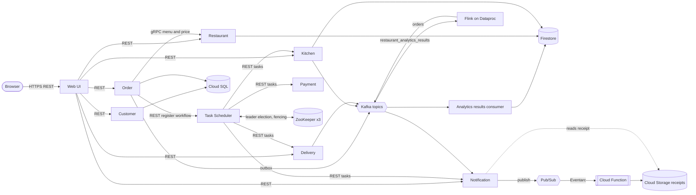

# Requirements Map and Demo Runbook

Maps each course requirement (a to h) to the code, says whether it is met, and gives the demo steps. Status was checked against the repository; **nothing here has been run on a real Google Cloud project yet**, so "built" means the code and Terraform exist and validate, not that a live demo was rehearsed.

Placeholders: `<project>` is your project ID, `<prefix>` is the `prefix` variable (default `food`), `<state-bucket>` is the Terraform state bucket.

## Summary

| Req | What it asks | Status | Where |
|---|---|---|---|
| a | All infrastructure from Infrastructure as Code | Met in code; real plan clean, apply pending | `deploy/terraform/cloud/` (one root), `modules/argocd/`, `state/` (one-time bucket) |
| b | One serverless function; REST, gRPC and a message queue all used | Met | `functions/notification_transport/`; `order_service/dependencies.py` (gRPC); `web_ui/client.py` (REST); Kafka and Pub/Sub |
| c | Managed Kubernetes, two HPAs, k6 load test | Built, not yet proven live | `gke.tf`; `deploy/charts/food/templates/workloads.yaml`; `load/sustained.js` |
| d | GitOps controller tracks Git; no `kubectl apply` for services | Met in design | `modules/argocd/`, `deploy/charts/`, `deploy/environments/` |
| e | Flink on Dataproc: Kafka in, stateful time windows, results to a second topic | Met | `restaurant_service/analytics/`, `dataproc.tf`, `kafka.tf` |
| f | The scenario's concept applied to the domain (ZooKeeper) | Met | `task_scheduler/leader.py`, `charts/food/templates/zookeeper.yaml` |
| g | At least three storage products | Met | Cloud SQL, Firestore, Cloud Storage |
| h | Prometheus and Grafana dashboard; centralized logging | Met in design | `deploy/charts/platform/`, Cloud Logging, `monitoring.tf` |

## Architecture



Reading it: REST carries browser and service-to-service calls; gRPC is used between Order and Restaurant; Kafka and Pub/Sub are the message queues; the Cloud Function is the serverless piece.

## Where each requirement lives, and how to demo it

### A. Infrastructure as Code (req a)
- **Show:** `ls deploy/terraform/cloud/*.tf`, then run it.
- **Commands:**
  ```bash
  # one-time: create the remote-state bucket
  terraform -chdir=deploy/terraform/state init && terraform -chdir=deploy/terraform/state apply
  # the whole platform
  terraform -chdir=deploy/terraform/cloud init -backend-config="bucket=<state-bucket>" -backend-config="prefix=food/cloud"
  terraform -chdir=deploy/terraform/cloud plan
  terraform -chdir=deploy/terraform/cloud apply
  ```
- **Needs on the machine:** Terraform 1.6+, Docker, gcloud signed in (`gcloud auth application-default login`), and the secrets as `TF_VAR_*` environment variables (see `deploy/terraform/cloud/terraform.tfvars.example`).
- **Every person runs their own stack:** each person sets their own `project_id` and `prefix` in their `terraform.tfvars`.
- **Argo CD needs nothing rendered or pushed first:** Terraform creates the Argo CD Applications and passes the project's settings inline; the repo holds only charts and `deploy/environments/team/image.yaml`.
- **Honest limits:** the Flink jar upload is one `local-exec` step inside apply. Schema creation, the Flink job submit and pause/resume are kept as application or operations steps (see `trace.md`, Group J). The Confluent Kafka cluster and keys are created outside Terraform; with `enable_kafka = false` the platform can be applied without them.

### B. Serverless, REST, gRPC and queues (req b)
- **Serverless:** the Cloud Function `<prefix>-notification-transport` (`functions/notification_transport/main.py`). Notification Service publishes to Pub/Sub; Eventarc triggers the function; it writes a receipt object to Cloud Storage; Notification Service marks the message delivered only after seeing that receipt. Only this transport is serverless, not the whole Notification Service.
- **Show:** console, Cloud Functions, then Eventarc, then Pub/Sub topic `<prefix>-notification-dispatch`; place an order in the UI; function logs; receipt in `gs://<project>-<prefix>-receipts/notifications/v1/`.
- **gRPC:** Order calls Restaurant (`order_service/dependencies.py`, contract `restaurant_service/restaurant.proto`). **REST:** the UI and most service-to-service calls. **Queues:** Kafka (orders, kitchen_status, delivery_assignments, restaurant_analytics_results) and Pub/Sub. Use the diagram above.
- **Be ready to say:** internal calls are mostly REST; gRPC is used for the Order to Restaurant path only, and that channel is plaintext inside the private network.

### C. Kubernetes, HPAs and load (req c)
- **Managed Kubernetes:** GKE (`gke.tf`). **HPAs:** `customer-service` and `order-service`, CPU 60% and memory 75%, 1 to 6 replicas by default (`deploy/charts/food/values.yaml`).
- **Before:**
  ```bash
  kubectl -n food get hpa
  kubectl -n food get pods
  ```
- **Generate load through Git (so it stays GitOps):** in `deploy/environments/team/food-values.json` set `loadTest.enabled` to `true` and a fresh `loadTest.runId`, commit and push. Argo CD runs the k6 job (`load/sustained.js`, 60 virtual users, ramp 1m, hold 8m by default).
- **During and after:** `kubectl -n food get hpa -w` and `kubectl -n food get pods -w`; the Cloud Monitoring dashboard "`<prefix>` platform" has tiles for pod CPU utilization against the 60% target and for running pod counts of both services. Scale-down waits 180 seconds.
- **Not yet proven:** a real run on the small demo node pool may need the virtual users or the target raised to trigger scale-out.

### D. GitOps with Argo CD (req d)
- **Install:** Terraform installs Argo CD and a root Application (`modules/argocd/`). The root app syncs `deploy/environments/team/` with prune and self-heal.
- **Open the dashboard:**
  ```bash
  kubectl -n argocd port-forward svc/argocd-server 8080:443
  kubectl -n argocd get secret argocd-initial-admin-secret -o jsonpath="{.data.password}" | base64 -d
  ```
- **Demo of an update:** change a value in Git (for example replica counts or an environment setting), `git push`, and watch the Application go OutOfSync then Synced in the dashboard. For a code change, set a new tag in `deploy/environments/team/image.yaml`, run `terraform apply` (it builds and pushes that tag), then `git push`; Argo CD rolls the new image out.
- **Honest limits:** there is no CI pipeline, so the image build is triggered by `terraform apply`, not by `git push`. `deploy/lifecycle_cloud.py` uses `kubectl scale/patch` for pause and resume; do not present that as deployment.

### E. Flink stream processing (req e)
- **What it does:** `RestaurantAnalytics.java` reads Kafka topic `orders`, keys events by restaurant and one-minute window, keeps state (distinct event IDs, distinct orders, per-stage counts), uses event-time watermarks (3 s out of order, 10 s idle), and writes one result per window to Kafka topic `restaurant_analytics_results` with exactly-once delivery. Checkpoints go to Cloud Storage.
- **Show:** console, Dataproc, Clusters, `<prefix>-flink`, Web Interfaces (Component Gateway is enabled by Terraform), open the YARN application and the Flink UI; Dataproc Jobs; the two topics in Confluent Cloud; the results appearing in Firestore collection `restaurant_analytics_v1` and in the UI analytics page.
- **Note:** the example in the requirement counts unique users; this job counts unique orders per restaurant per minute, the same kind of aggregation.

### F. ZooKeeper concept (req f)
- **What it does:** the Task Scheduler runs two replicas that contend for leadership through ZooKeeper (`task_scheduler/leader.py`). The leader's epoch is stored in SQL so a stale leader is fenced out; workers and the Payment service verify the fencing proof.
- **Show the leader:**
  ```bash
  kubectl -n food port-forward svc/task-api 8085:8085
  curl -s localhost:8085/scheduler          # leader.name is the leader's pod name, plus its epoch
  kubectl -n food exec zookeeper-0 -- zkCli.sh -server localhost:2181 get /food-delivery/tasks-v1/leader
  ```
- **Kill it and show the new leader:**
  ```bash
  kubectl -n food delete pod <leader pod name>
  curl -s localhost:8085/scheduler          # a different pod name and a higher epoch
  ```
- **Note:** `DESIGN.md` still lists "course scenario confirmation" as open; ZooKeeper is the concept the owner confirmed.

### G. Three storage products (req g)

| Product | Used for | Terraform | Code |
|---|---|---|---|
| Cloud SQL (MySQL) | Relational data for every service: customers, orders, scheduler, payments, kitchen, delivery, notifications | `database.tf` | `customer_service/customer_service.py`, each `*_service/models.py` and `schema.py`, `deploy/initialize.py` |
| Firestore | Restaurant catalog, kitchen ticket view, streaming analytics results | `database.tf` | `common/deployment.py`, `restaurant_service/repository.py`, `kitchen_workflow/projection.py`, `restaurant_service/analytics_results.py` |
| Cloud Storage | Notification receipts written by the function, Flink checkpoints, build artifacts, Terraform state | `storage.tf` | `notification_service/cloud_transport.py`, `functions/notification_transport/main.py`, `RestaurantAnalytics.java` |

- **Show:** console pages for SQL instance `<prefix>-sql`, Firestore collections `restaurants` and `restaurant_analytics_v1`, and buckets `<project>-<prefix>-receipts`, `-checkpoints` and `-artifacts`; then open the code files above.

### H. Observability (req h)
- **Metrics:** Prometheus and Grafana from `deploy/charts/platform/` (kube-prometheus-stack in namespace `monitoring`). The dashboard `deploy/charts/platform/dashboards/system.json` shows requests per second, server error fraction, p95 latency, metrics endpoints up, ready pods and pod restarts per namespace.
  ```bash
  kubectl -n monitoring get svc | grep grafana
  kubectl -n monitoring port-forward svc/<grafana service name> 3000:80
  ```
- **Logging:** Cloud Logging collects logs from every workload (GKE) and from the analytics job (Dataproc). In Logs Explorer use `resource.type="k8s_container" AND resource.labels.namespace_name="food"` for the services and `resource.type="cloud_dataproc_cluster"` for Flink. The "`<prefix>` platform" dashboard also charts error log lines from both, through two log-based metrics defined in `monitoring.tf`.
- **Also in Terraform:** three alert policies (Cloud SQL CPU, GKE node CPU, notification function errors) in `monitoring.tf`.

## Known gaps before the demo
- No real run yet. Alert filters, dashboard tiles, the Component Gateway and HPA scale-out are validated for syntax only.
- No CI pipeline: new images are built by `terraform apply`.
- Argo CD, Grafana and the scheduler API are reached by `kubectl port-forward`; there is no public ingress for them.
- The Confluent Kafka cluster and its API keys, and the DNS zone, are created outside Terraform.
